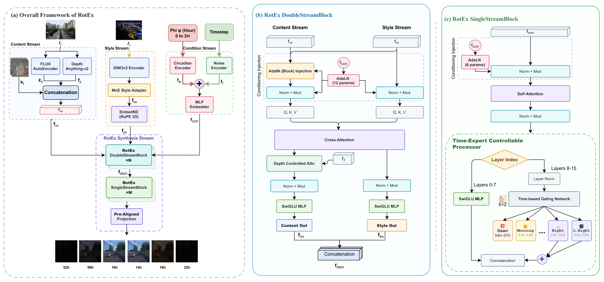
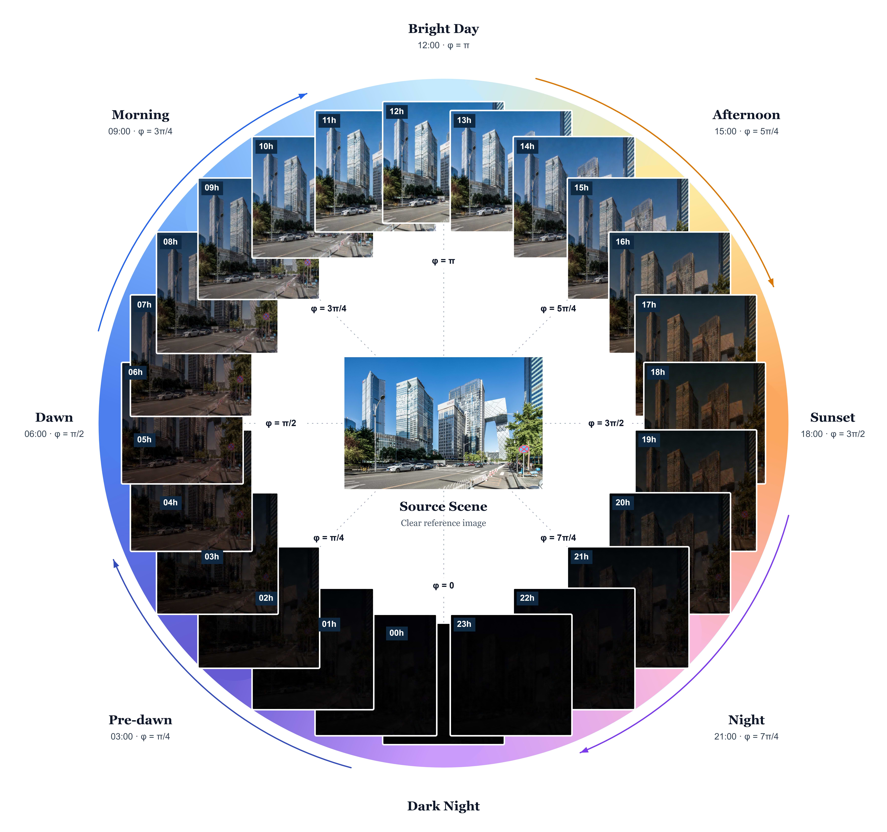
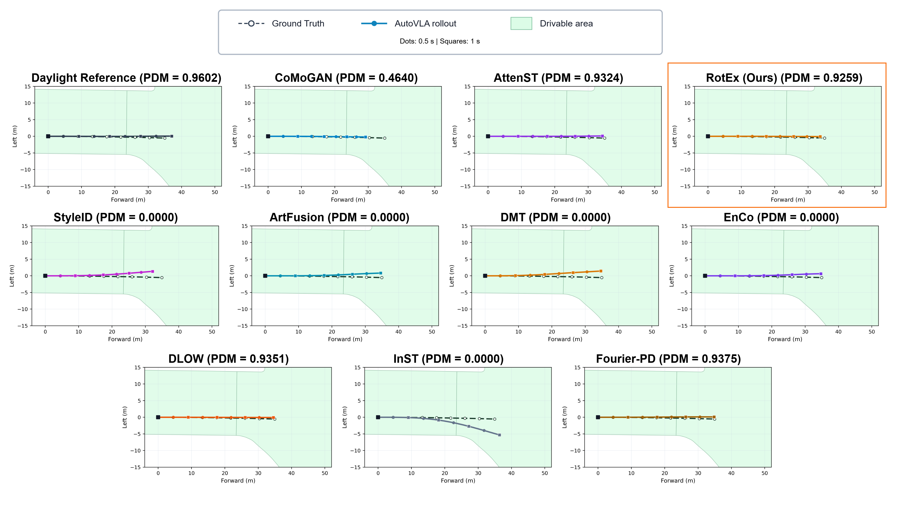

# [Official] RotEx: A Rotational Expert Network for Realistic Scene Illumination Variation Synthesis

<p align="center">
    📄 <b>Paper: coming soon</b>&nbsp;&nbsp; | &nbsp;&nbsp;
    💻 <a href="https://github.com/val-utehy/RotEx"><b>Source Code</b></a>&nbsp;&nbsp; | &nbsp;&nbsp;
    🤗 <a href="https://huggingface.co/val-utehy/RotEx"><b>Hugging Face</b></a>
</p>

<p align="center">
    
</p>

## Introduction

**RotEx** is a transformer-based image-to-image framework for synthesizing scenes under varying illumination conditions. It combines content latents, depth information, style features, and a continuous time-of-day variable to generate illumination variations of an input scene.

### Key Features

- **Continuous illumination control:** Generate scene variations across different times of the day.
- **Illumination-dependent experts:** Adapt style and image features through time-conditioned expert routing.
- **Content and depth conditioning:** Guide synthesis using content latents and estimated scene depth.
- **Multi-step and one-step inference:** Support full-model sampling and distilled single-step generation.
- **Image and video processing:** Process image directories and videos with reference-style conditioning.

## Demo

### Illumination Variation

<p align="center">
    
</p>

### Downstream Trajectory Comparison

<p align="center">
    
</p>

## Installation

**Requirements:** Python ≥ 3.10, PyTorch ≥ 2.6, a compatible torchvision version, FlashAttention ≥ 2.0, and an NVIDIA GPU with CUDA.

```shell
git clone https://github.com/val-utehy/RotEx.git
cd RotEx

conda create -n rotex python=3.10 -y
conda activate rotex
python -m pip install --upgrade pip
```

Install CUDA-enabled PyTorch and torchvision following the [PyTorch instructions](https://pytorch.org/get-started/locally/), then run:

```shell
python -m pip install packaging ninja psutil
python -m pip install "flash-attn>=2.0.0" --no-build-isolation
python -m pip install -r requirements.txt
```

## Pretrained Models

Download weights from [Hugging Face](https://huggingface.co/val-utehy/RotEx/tree/main):

| Model | Download | Save to |
| --- | --- | --- |
| Multi-step | [best.pt](https://huggingface.co/val-utehy/RotEx/resolve/main/checkpoints/full/best.pt?download=true) | `checkpoints/full/best.pt` |
| Multi-step, final | [last.pt](https://huggingface.co/val-utehy/RotEx/resolve/main/checkpoints/full/last.pt?download=true) | `checkpoints/full/last.pt` |
| One-step | [best_distill.pt](https://huggingface.co/val-utehy/RotEx/resolve/main/distill_checkpoints/best_distill.pt?download=true) | `distill_checkpoints/best_distill.pt` |

```shell
hf download val-utehy/RotEx checkpoints/full/best.pt --local-dir .
hf download val-utehy/RotEx distill_checkpoints/best_distill.pt --local-dir .
hf download black-forest-labs/FLUX.1-dev ae.safetensors --local-dir checkpoints
```

DINOv2 and Depth Anything V2 are downloaded automatically. Run `hf auth login` if model access requires authentication.

### Expected Weights Structure

```text
RotEx/
├── checkpoints/
│   ├── ae.safetensors
│   └── full/
│       ├── best.pt
│       └── last.pt                 # Optional
└── distill_checkpoints/
    └── best_distill.pt
```

## Usage

### 1. Training

Will be updated soon.

### 2. Multi-Step Image Inference

```shell
python infer_multistep.py \
    --checkpoint checkpoints/full/best.pt \
    --content_dir inputs/content \
    --style_dir inputs/style \
    --output_dir outputs/multistep \
    --denoise_steps 50
```

### 3. One-Step Image Inference

Set these paths in `infer_1step_style.py`:

```python
CHECKPOINT = "distill_checkpoints/best_distill.pt"
FIXED_STYLE_PATH = "inputs/style/night_reference.jpg"
DATA_PAIRS = [
    {"input": "inputs/content", "output": "outputs/1step_style"},
]
HOURS = list(range(1, 25))
```

```shell
python infer_1step_style.py
```

### 4. Multi-Step Video Inference

```shell
python infer_multistep_vid.py \
    --checkpoint checkpoints/full/best.pt \
    --video_path inputs/video.mp4 \
    --style_path inputs/style/night_reference.jpg \
    --output_dir outputs/video \
    --denoise_steps 50 \
    --hour_start 0 \
    --hour_end 24 \
    --no_audio
```

## Citation

<!-- Paper details and the official BibTeX entry will be added when available. -->

## References

- [FLUX](https://github.com/black-forest-labs/flux)
- [DINOv2](https://github.com/facebookresearch/dinov2)
- [Depth Anything V2](https://github.com/DepthAnything/Depth-Anything-V2)
- [FlashAttention](https://github.com/Dao-AILab/flash-attention)

## License

This project is licensed under the [Apache License 2.0](LICENSE). Third-party components retain their respective licenses.
